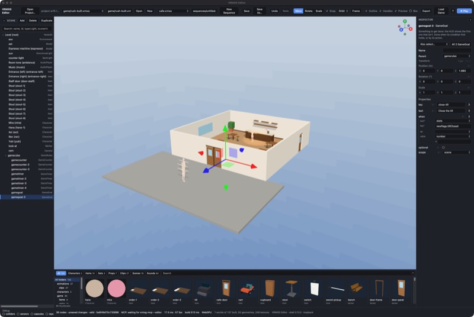
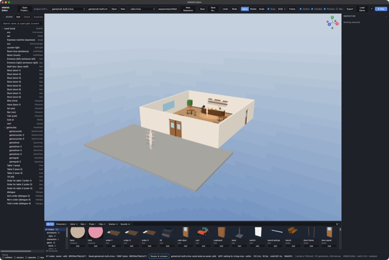

# The sample game's level, built in the editor (M5 W10): AppProbe scenario: run of Nov 25, 2026 at 2:44 PM

- **App:** VRMXG Editor 0.1.0 (1), apps/editor-mac/build/VRMXGEditor.app
- **Scenario:** `apps/editor-mac/docs/hand-test/HAND-TEST-M5-LEVEL.scenario.md`
- **Checklist:** `apps/editor-mac/docs/HAND-TEST-M5-LEVEL.md`
- **Result:** 13 rows: 11 passed, 2 failed, 0 need you; 0 checklist rows have no steps

## Failed

### 5. The two goals in order and the checkpoint, each with its condition built in the condition…

** (checklist line 14)

> The two goals in order and the checkpoint, each with its condition built in the condition's fields.

**Failed:** after 5000 ms, still not find("id=prop-when-key").0.value == "flags.tillClosed": "newflags.tillClosed"

- 👀 shot 1: end
- ✅ `find("role=popupbutton name='Node type to add'").0.value == "GameGoal"`
- ✅ `find("id=undo").0.name == "Undo Add gamegoal"`
- ✅ `find("id=field-parent").0.value == "gamerules"`
- ✅ `find("id=prop-key").0.value == "serve"`
- ✅ `find("id=prop-text").0.value == "Serve the three regulars"`
- ✅ `find("id=prop-when-test").0.value == "all"`
- ✅ `find("id=prop-when-of-0").count == 1`
- ✅ `find("id=prop-when-of-0-key").0.value == "counters.served"`
- ✅ `find("id=prop-when-of-0-op").0.value == "ge"`
- ✅ `find("id=prop-when-of-0-value").0.value == "3"`
- ✅ `find("id=prop-when-of-1").count == 1`
- ✅ `find("id=prop-when-of-1-key").0.value == "counters.mistakes"`
- ✅ `find("id=prop-when-of-1-op").0.value == "lt"`
- ✅ `find("id=prop-when-of-1-value").0.value == "2"`
- ✅ `find("id=prop-when-of").0.name == "when of, 2 rows"`
- ✅ `find("role=popupbutton name='Node type to add'").0.value == "GameGoal"`
- ✅ `find("id=undo").0.name == "Undo Add gamegoal-2"`
- ✅ `find("id=field-parent").0.value == "gamerules"`
- ✅ `find("id=prop-key").0.value == "close-till"`
- ✅ `find("id=prop-text").0.value == "Close the till"`
- ✅ `find("id=prop-when-test").0.value == "all"`
- ✅ `find("id=prop-when-test").0.value == "state"`
- ❌ `find("id=prop-when-key").0.value == "flags.tillClosed"`, got `"newflags.tillClosed"`



<details><summary>Steps (39740 ms)</summary>

```
226: act id=file-name action=focus → {"action":"focus","delivery":"delivered","element":{"frame":{"h":27,"w":139,"x":3159,"y":171},"help":"The file New and Save As use, in the project","id":"file-n (64 ms)
227: act role=popupbutton name="Node type to add" action=focus → {"action":"focus","delivery":"delivered","element":{"frame":{"h":22,"w":3,"x":2694,"y":223},"help":"","name":"Node type to add","ref":"W:VRMXG Editor/0/0/0/0/1/ (72 ms)
229: keys down → {"sent":true} (113 ms)
230: act surface=app role=menuitem name="GameGoal" exact=true action=press → {"action":"press","delivery":"delivered","element":{"frame":{"h":24,"w":145,"x":2681,"y":247},"id":"_popUpItemAction:","name":"GameGoal","ref":"A/0/0/1/18@fd9b" (79 ms)
231: until find("role=popupbutton name='Node type to add'").0.value == "GameGoal" timeout=5000 → ok (697 ms)
232: act id=add-node action=press → {"action":"press","delivery":"delivered","element":{"frame":{"h":27,"w":43,"x":2702,"y":221},"help":"","id":"add-node","name":"Add node","ref":"W:VRMXG Editor/0 (53 ms)
233: until find("id=undo").0.name == "Undo Add gamegoal" timeout=5000 → ok (1204 ms)
234: act id=field-parent action=focus → {"action":"focus","delivery":"delivered","element":{"frame":{"h":22,"w":150,"x":4909,"y":403},"help":"","id":"field-parent","name":"Parent","ref":"W:VRMXG Edito (132 ms)
236: keys down → {"sent":true} (108 ms)
237: act surface=app role=menuitem name="gamerules" exact=true action=press → {"action":"press","delivery":"delivered","element":{"frame":{"h":24,"w":150,"x":4896,"y":1027},"id":"_popUpItemAction:","name":"gamerules","ref":"A/0/0/1/27@e67 (81 ms)
238: until find("id=field-parent").0.value == "gamerules" timeout=5000 → ok (1721 ms)
239: act id=prop-key action=set_value value="serve" → {"action":"set_value","delivery":"delivered","element":{"frame":{"h":27,"w":150,"x":4909,"y":653},"help":"","id":"prop-key","name":"key","ref":"W:VRMXG Editor/0 (480 ms)
240: until find("id=prop-key").0.value == "serve" timeout=5000 → ok (831 ms)
241: act id=prop-text action=set_value value="Serve the three regulars" → {"action":"set_value","delivery":"delivered","element":{"frame":{"h":27,"w":150,"x":4909,"y":685},"help":"","id":"prop-text","name":"text","ref":"W:VRMXG Editor (501 ms)
242: until find("id=prop-text").0.value == "Serve the three regulars" timeout=5000 → ok (1116 ms)
243: act id=prop-when-test action=focus → {"action":"focus","delivery":"delivered","element":{"frame":{"h":22,"w":191,"x":4868,"y":738},"help":"","id":"prop-when-test","name":"when test","ref":"W:VRMXG  (118 ms)
245: keys down → {"sent":true} (106 ms)
246: act surface=app role=menuitem name="all" exact=true action=press → {"action":"press","delivery":"delivered","element":{"frame":{"h":24,"w":191,"x":4855,"y":761},"id":"_popUpItemAction:","name":"all","ref":"A/0/0/1/1@d689","role (79 ms)
247: until find("id=prop-when-test").0.value == "all" timeout=5000 → ok (1466 ms)
248: until find("id=prop-when-of-0").count == 1 timeout=5000 → ok (76 ms)
250: act id=prop-when-of-0-key action=set_value value="counters.served" → {"action":"set_value","delivery":"delivered","element":{"frame":{"h":27,"w":99,"x":4960,"y":812},"help":"","id":"prop-when-of-0-key","name":"when of 1 key","ref (486 ms)
251: until find("id=prop-when-of-0-key").0.value == "counters.served" timeout=5000 → ok (880 ms)
252: act id=prop-when-of-0-op action=focus → {"action":"focus","delivery":"delivered","element":{"frame":{"h":22,"w":99,"x":4960,"y":842},"help":"","id":"prop-when-of-0-op","name":"when of 1 op","ref":"W:V (92 ms)
254: keys down → {"sent":true} (115 ms)
255: act surface=app role=menuitem name="ge" exact=true action=press → {"action":"press","delivery":"delivered","element":{"frame":{"h":24,"w":99,"x":4947,"y":913},"id":"_popUpItemAction:","name":"ge","ref":"A/0/0/1/3@989e","role": (79 ms)
256: until find("id=prop-when-of-0-op").0.value == "ge" timeout=5000 → ok (1571 ms)
257: act id=prop-when-of-0-value action=set_value value="3" → {"action":"set_value","delivery":"delivered","element":{"frame":{"h":27,"w":85,"x":4974,"y":892},"help":"","id":"prop-when-of-0-value","name":"when of 1 value", (544 ms)
258: until find("id=prop-when-of-0-value").0.value == "3" timeout=5000 → ok (863 ms)
259: act id=prop-when-of--add action=press → {"action":"press","delivery":"delivered","element":{"frame":{"h":24,"w":49,"x":4876,"y":922},"help":"","id":"prop-when-of--add","name":"Add a row to when of","r (89 ms)
260: until find("id=prop-when-of-1").count == 1 timeout=5000 → ok (1008 ms)
262: act id=prop-when-of-1-key action=set_value value="counters.mistakes" → {"action":"set_value","delivery":"delivered","element":{"frame":{"h":27,"w":99,"x":4960,"y":967},"help":"","id":"prop-when-of-1-key","name":"when of 2 key","ref (471 ms)
263: until find("id=prop-when-of-1-key").0.value == "counters.mistakes" timeout=5000 → ok (824 ms)
264: act id=prop-when-of-1-op action=focus → {"action":"focus","delivery":"delivered","element":{"frame":{"h":22,"w":99,"x":4960,"y":997},"help":"","id":"prop-when-of-1-op","name":"when of 2 op","ref":"W:V (93 ms)
266: keys down → {"sent":true} (109 ms)
267: act surface=app role=menuitem name="lt" exact=true action=press → {"action":"press","delivery":"delivered","element":{"frame":{"h":24,"w":99,"x":4947,"y":1093},"id":"_popUpItemAction:","name":"lt","ref":"A/0/0/1/4@ba3a","role" (82 ms)
268: until find("id=prop-when-of-1-op").0.value == "lt" timeout=5000 → ok (1752 ms)
269: act id=prop-when-of-1-value action=set_value value="2" → {"action":"set_value","delivery":"delivered","element":{"frame":{"h":27,"w":85,"x":4974,"y":1047},"help":"","id":"prop-when-of-1-value","name":"when of 2 value" (494 ms)
270: until find("id=prop-when-of-1-value").0.value == "2" timeout=5000 → ok (973 ms)
271: expect find("id=prop-when-of").0.name == "when of, 2 rows" → ok (92 ms)
272: act id=file-name action=focus → {"action":"focus","delivery":"delivered","element":{"frame":{"h":27,"w":139,"x":3159,"y":171},"help":"The file New and Save As use, in the project","id":"file-n (60 ms)
273: act role=popupbutton name="Node type to add" action=focus → {"action":"focus","delivery":"delivered","element":{"frame":{"h":22,"w":3,"x":2694,"y":223},"help":"","name":"Node type to add","ref":"W:VRMXG Editor/0/0/0/0/1/ (72 ms)
275: keys down → {"sent":true} (114 ms)
276: act surface=app role=menuitem name="GameGoal" exact=true action=press → {"action":"press","delivery":"delivered","element":{"frame":{"h":24,"w":145,"x":2681,"y":223},"id":"_popUpItemAction:","name":"GameGoal","ref":"A/0/0/1/18@fd9b" (89 ms)
277: until find("role=popupbutton name='Node type to add'").0.value == "GameGoal" timeout=5000 → ok (60 ms)
278: act id=add-node action=press → {"action":"press","delivery":"delivered","element":{"frame":{"h":27,"w":43,"x":2702,"y":221},"help":"","id":"add-node","name":"Add node","ref":"W:VRMXG Editor/0 (78 ms)
279: until find("id=undo").0.name == "Undo Add gamegoal-2" timeout=5000 → ok (1005 ms)
280: act id=field-parent action=focus → {"action":"focus","delivery":"delivered","element":{"frame":{"h":22,"w":150,"x":4909,"y":409},"help":"","id":"field-parent","name":"Parent","ref":"W:VRMXG Edito (74 ms)
282: keys down → {"sent":true} (115 ms)
283: act surface=app role=menuitem name="gamerules" exact=true action=press → {"action":"press","delivery":"delivered","element":{"frame":{"h":24,"w":150,"x":4896,"y":1032},"id":"_popUpItemAction:","name":"gamerules","ref":"A/0/0/1/27@e67 (87 ms)
284: until find("id=field-parent").0.value == "gamerules" timeout=5000 → ok (1713 ms)
285: act id=prop-key action=set_value value="close-till" → {"action":"set_value","delivery":"delivered","element":{"frame":{"h":27,"w":150,"x":4909,"y":658},"help":"","id":"prop-key","name":"key","ref":"W:VRMXG Editor/0 (456 ms)
286: until find("id=prop-key").0.value == "close-till" timeout=5000 → ok (965 ms)
287: act id=prop-text action=set_value value="Close the till" → {"action":"set_value","delivery":"delivered","element":{"frame":{"h":27,"w":150,"x":4909,"y":691},"help":"","id":"prop-text","name":"text","ref":"W:VRMXG Editor (495 ms)
288: until find("id=prop-text").0.value == "Close the till" timeout=5000 → ok (805 ms)
289: act id=prop-when-test action=focus → {"action":"focus","delivery":"delivered","element":{"frame":{"h":22,"w":191,"x":4868,"y":743},"help":"","id":"prop-when-test","name":"when test","ref":"W:VRMXG  (70 ms)
291: keys down → {"sent":true} (115 ms)
292: act surface=app role=menuitem name="all" exact=true action=press → {"action":"press","delivery":"delivered","element":{"frame":{"h":24,"w":191,"x":4855,"y":766},"id":"_popUpItemAction:","name":"all","ref":"A/0/0/1/1@d689","role (83 ms)
293: until find("id=prop-when-test").0.value == "all" timeout=5000 → ok (1392 ms)
294: act id=prop-when-test action=focus → {"action":"focus","delivery":"delivered","element":{"frame":{"h":22,"w":191,"x":4868,"y":747},"help":"","id":"prop-when-test","name":"when test","ref":"W:VRMXG  (62 ms)
296: keys down → {"sent":true} (110 ms)
297: act surface=app role=menuitem name="state" exact=true action=press → {"action":"press","delivery":"delivered","element":{"frame":{"h":24,"w":191,"x":4855,"y":722},"id":"_popUpItemAction:","name":"state","ref":"A/0/0/1/0@8955","ro (75 ms)
298: until find("id=prop-when-test").0.value == "state" timeout=5000 → ok (1555 ms)
300: act id=prop-when-key action=set_value value="flags.tillClosed" → {"action":"set_value","delivery":"delivered","element":{"frame":{"h":27,"w":191,"x":4868,"y":772},"help":"","id":"prop-when-key","name":"when key","ref":"W:VRMX (471 ms)
301: until find("id=prop-when-key").0.value == "flags.tillClosed" timeout=5000 → timed out, last "newflags.tillClosed" (5035 ms)
```
</details>

### 13. Saved, and read back from disk the same bytes, valid; the file is what rush-level

** (checklist line 22)

> Saved, and read back from disk the same bytes, valid; the file is what rush-level.mjs compares with the committed level.

**Failed:** expected find("id=doc-state").0.name matches "^Scene game/rush-built.vrmxs 48 nodes saved valid ", got "Scene game/rush-built.vrmxs 47 nodes saved valid hash 66f03be7f6a2cd11"

- 👀 shot 1: end
- ✅ `find("id=saved").0.name matches "^Saved game/rush-built.vrmxs · [0-9]+ bytes · [0-9a-f]{16}$"`
- ✅ `find("id=verify-result").0.name == "Reopened game/rush-built.vrmxs: same bytes as saved, valid"`
- ❌ `find("id=doc-state").0.name matches "^Scene game/rush-built.vrmxs 48 nodes saved valid "`, got `"Scene game/rush-built.vrmxs 47 nodes saved valid hash 66f03be7f6a2cd11"`



<details><summary>Steps (1138 ms)</summary>

```
829: act id=save action=press → {"action":"press","delivery":"delivered","element":{"frame":{"h":27,"w":47,"x":3867,"y":171},"help":"","id":"save","name":"Save","ref":"W:VRMXG Editor/0/0/0/0/0 (54 ms)
830: until find("id=saved").0.name matches "^Saved game/rush-built.vrmxs · [0-9]+ bytes · [0-9a-f]{16}$" timeout=20000 → ok (74 ms)
831: act id=verify action=press → {"action":"press","delivery":"delivered","element":{"frame":{"h":26,"w":127,"x":3552,"y":1743},"help":"","id":"verify","name":"Reopen and compare","ref":"W:VRMX (62 ms)
832: until find("id=verify-result").0.name == "Reopened game/rush-built.vrmxs: same bytes as saved, valid" timeout=30000 → ok (416 ms)
833: expect find("id=doc-state").0.name matches "^Scene game/rush-built.vrmxs 48 nodes saved valid " → got "Scene game/rush-built.vrmxs 47 nodes saved valid hash 66f03be7f6a2cd11" (48 ms)
```
</details>

## Passed

- **1. The level's room opens: the set, the doors and stools, Mira, Hana and the three regulars,…** (checklist line 10): find("id=project-name").0.name == "Project project-w10-level"; find("id=doc-state").0.name matches "^Scene game/rush-built.vrmxs 26 nodes saved valid "; find("id=renderer").0.name == "Renderer WebGPU"; find("id=node-aoi").count == 1; find("id=node-hana-1").count == 1 (10273 ms)
- **2. The rules: a GameRules node with its seven flags (a map, key by key) and its lose conditi…** (checklist line 11): find("role=popupbutton name='Node type to add'").0.value == "GameRules"; find("id=undo").0.name == "Undo Add gamerules"; find("id=prop-flags-ordered1").count == 1; find("id=prop-flags-ordered2").count == 1; find("id=prop-flags-ordered3").count == 1; find("id=prop-flags-right1").count == 1; find("id=prop-flags-right2").count == 1; find("id=prop-flags-right3").count == 1; find("id=prop-flags-tillClosed").count == 1; find("id=prop-flags").0.name == "flags, 7 entries"; find("id=prop-lose-test").0.value == "any"; find("id=prop-lose-of-0").count == 1; find("id=prop-lose-of-0-key").0.value == "timers.clock.done"; find("id=prop-lose-of-1").count == 1; find("id=prop-lose-of-1-key").0.value == "counters.mistakes"; find("id=prop-lose-of-1-op").0.value == "ge"; find("id=prop-lose-of-1-value").0.value == "2"; find("id=prop-lose-of").0.name == "lose of, 2 rows"; find("id=doc-state").0.name matches " valid " (24720 ms)
- **3. The counters and the clock under the rules: keys, labels, a maximum typed as arithmetic, …** (checklist line 12): find("role=popupbutton name='Node type to add'").0.value == "GameCounter"; find("id=undo").0.name == "Undo Add gamecounter"; find("id=field-parent").0.value == "gamerules"; find("id=prop-key").0.value == "score"; find("id=prop-label").0.value == "Score"; find("role=popupbutton name='Node type to add'").0.value == "GameCounter"; find("id=undo").0.name == "Undo Add gamecounter-2"; find("id=field-parent").0.value == "gamerules"; find("id=prop-key").0.value == "served"; find("id=prop-label").0.value == "Served"; find("id=prop-max").0.value == "3"; find("role=popupbutton name='Node type to add'").0.value == "GameCounter"; find("id=undo").0.name == "Undo Add gamecounter-3"; find("id=field-parent").0.value == "gamerules"; find("id=prop-key").0.value == "mistakes"; find("id=prop-label").0.value == "Wrong orders"; find("role=popupbutton name='Node type to add'").0.value == "GameTimer"; find("id=undo").0.name == "Undo Add gametimer"; find("id=field-parent").0.value == "gamerules"; find("id=prop-key").0.value == "clock"; find("id=prop-label").0.value == "Until ten o'clock"; find("id=prop-seconds").0.value == "240"; find("id=doc-state").0.name matches " valid " (31654 ms)
- **4. Three brew timers: one made, Duplicated twice, then all three selected and their seconds …** (checklist line 13): find("role=popupbutton name='Node type to add'").0.value == "GameTimer"; find("id=undo").0.name == "Undo Add gametimer-2"; find("id=field-parent").0.value == "gamerules"; find("id=prop-autostart").0.value == "0"; find("id=node-gametimer-3").count == 1; find("id=undo").0.name == "Undo Duplicate gametimer-2"; find("id=node-gametimer-4").count == 1; find("id=undo").0.name == "Undo Duplicate gametimer-3"; find("id=inspector-id").0.name == "Node gametimer-2"; find("id=inspector-id").0.name == "3 nodes: gametimer-2, gametimer-3, gametimer-4"; find("id=undo").0.name == "Undo Set seconds on 3 nodes"; find("id=prop-seconds").0.value == "6"; find("id=inspector-id").0.name == "Node gametimer-2"; find("id=prop-key").0.value == "brew-1"; find("id=inspector-id").0.name == "Node gametimer-3"; find("id=prop-key").0.value == "brew-2"; find("id=inspector-id").0.name == "Node gametimer-4"; find("id=prop-key").0.value == "brew-3"; find("id=doc-state").0.name matches " valid " (16219 ms)
- **6. The three table areas: one made and sized (a vector), Duplicated twice, then all three se…** (checklist line 15): find("role=popupbutton name='Node type to add'").0.value == "Area"; find("id=undo").0.name == "Undo Add area"; find("id=prop-size-x").0.value == "1.1"; find("id=prop-size-y").0.value == "2"; find("id=prop-size-z").0.value == "1.8"; find("id=node-area-2").count == 1; find("id=node-area-3").count == 1; find("id=inspector-id").0.name matches "^3 nodes: "; find("id=prop-size-x").0.name != "size X (mixed values)"; find("id=prop-size-z").0.value == "1.8"; find("id=inspector-id").0.name == "Node area"; find("id=field-name").0.value == "Table 1"; find("id=pos-x").0.value == "-1.45"; find("id=pos-y").0.value == "1"; find("id=pos-z").0.value == "1"; find("id=inspector-id").0.name == "Node area-2"; find("id=field-name").0.value == "Table 2"; find("id=pos-x").0.value == "1.45"; find("id=pos-y").0.value == "1"; find("id=pos-z").0.value == "1"; find("id=inspector-id").0.name == "Node area-3"; find("id=field-name").0.value == "Table 3"; find("id=pos-x").0.value == "1.45"; find("id=pos-y").0.value == "1"; find("id=pos-z").0.value == "-2"; find("id=doc-state").0.name matches " valid " (26630 ms)
- **7. The till dragged from the assets panel onto the viewport (the real pointer), and the thre…** (checklist line 16): find("id=asset-game-items-till-vrmxi").count == 1; find("id=undo").0.name == "Undo Add till"; find("id=field-name").0.value == "Till"; find("id=pos-x").0.value == "-1.65"; find("id=pos-y").0.value == "1.06"; find("id=pos-z").0.value == "-3.95"; find("id=prop-state").0.value == "locked"; find("id=asset-game-items-order-1-vrmxi").count == 1; find("id=undo").0.name == "Undo Add order-1"; find("id=field-name").0.value == "Order for table 1"; find("id=pos-x").0.value == "-0.9"; find("id=pos-y").0.value == "1.06"; find("id=pos-z").0.value == "-3.95"; find("id=prop-state").0.value == "waiting"; find("id=asset-game-items-order-2-vrmxi").count == 1; find("id=undo").0.name == "Undo Add order-2"; find("id=field-name").0.value == "Order for table 2"; find("id=pos-x").0.value == "-0.1"; find("id=pos-y").0.value == "1.06"; find("id=pos-z").0.value == "-3.95"; find("id=prop-state").0.value == "waiting"; find("id=asset-game-items-order-3-vrmxi").count == 1; find("id=undo").0.name == "Undo Add order-3"; find("id=field-name").0.value == "Order for table 3"; find("id=pos-x").0.value == "0.6"; find("id=pos-y").0.value == "1.06"; find("id=pos-z").0.value == "-3.95"; find("id=prop-state").0.value == "waiting"; find("id=doc-state").0.name matches " valid " (33967 ms)
- **8. Hana's briefing: a Dialogue that starts by itself, three lines (speaker, text, clip, ids …** (checklist line 17): find("role=popupbutton name='Node type to add'").0.value == "Dialogue"; find("id=undo").0.name == "Undo Add dialogue"; find("id=prop-autostart").0.value == "1"; find("id=prop-lines").0.name == "lines, 1 row"; find("id=prop-lines-0-speaker").0.value == "hana-1"; find("id=prop-lines-0-text").0.value == "Morning, Mira! Three regulars are due. Take their orders, bring each one what I make, and close the till before ten."; find("id=prop-lines-0-clip").0.value == "game/voice/hana-brief.wav"; find("id=prop-lines-0-choices-0").count == 1; find("id=prop-lines-0-choices-0-id").0.value == "ready"; find("id=prop-lines-0-choices-0-text").0.value == "On it!"; find("id=prop-lines-0-choices-0-to").0.value == "ready"; find("id=prop-lines-0-choices-1").count == 1; find("id=prop-lines-0-choices-1-id").0.value == "coffee"; find("id=prop-lines-0-choices-1-text").0.value == "Coffee first?"; find("id=prop-lines-0-choices-1-to").0.value == "coffee"; find("id=prop-lines").0.name == "lines, 2 rows"; find("id=prop-lines-1-id").0.value == "ready"; find("id=prop-lines-1-speaker").0.value == "hana-1"; find("id=prop-lines-1-text").0.value == "That's the spirit. Here comes Aoi!"; find("id=prop-lines-1-clip").0.value == "game/voice/hana-brief-ready.wav"; find("id=prop-lines-1-next").0.value == "end"; find("id=prop-lines").0.name == "lines, 3 rows"; find("id=prop-lines-2-id").0.value == "coffee"; find("id=prop-lines-2-speaker").0.value == "hana-1"; find("id=prop-lines-2-text").0.value == "After the rush! Here comes Aoi."; find("id=prop-lines-2-clip").0.value == "game/voice/hana-brief-coffee.wav"; find("id=doc-state").0.name matches " valid " (28834 ms)
- **9. Aoi's order: three lines, the regular's question offering two choices, each setting the o…** (checklist line 18): find("role=popupbutton name='Node type to add'").0.value == "Dialogue"; find("id=undo").0.name == "Undo Add dialogue-2"; find("id=field-name").0.value == "Aoi's order"; find("id=prop-lines").0.name == "lines, 1 row"; find("id=prop-lines-0-speaker").0.value == "aoi"; find("id=prop-lines-0-text").0.value == "Morning! Something warm and milky, please. Not too strong."; find("id=prop-lines-0-clip").0.value == "game/voice/aoi-ask.wav"; find("id=prop-lines-0-choices-0").count == 1; find("id=prop-lines-0-choices-0-id").0.value == "latte"; find("id=prop-lines-0-choices-0-text").0.value == "A latte, then."; find("id=prop-lines-0-choices-0-to").0.value == "right"; find("id=prop-lines-0-choices-0-set").count == 1; find("id=prop-lines-0-choices-0-set-ordered1").count == 1; find("id=prop-lines-0-choices-0-set-ordered1").0.value == "1"; find("id=prop-lines-0-choices-0-set-right1").count == 1; find("id=prop-lines-0-choices-0-set-right1").0.value == "1"; find("id=prop-lines-0-choices-1").count == 1; find("id=prop-lines-0-choices-1-id").0.value == "espresso"; find("id=prop-lines-0-choices-1-text").0.value == "A double espresso?"; find("id=prop-lines-0-choices-1-to").0.value == "wrong"; find("id=prop-lines-0-choices-1-set").count == 1; find("id=prop-lines-0-choices-1-set-ordered1").count == 1; find("id=prop-lines-0-choices-1-set-ordered1").0.value == "1"; find("id=prop-lines-0-choices-1-set-right1").count == 1; find("id=prop-lines").0.name == "lines, 2 rows"; find("id=prop-lines-1-id").0.value == "right"; find("id=prop-lines-1-speaker").0.value == "aoi"; find("id=prop-lines-1-text").0.value == "Perfect. Thank you!"; find("id=prop-lines-1-clip").0.value == "game/voice/aoi-right.wav"; find("id=prop-lines-1-next").0.value == "end"; find("id=prop-lines").0.name == "lines, 3 rows"; find("id=prop-lines-2-id").0.value == "wrong"; find("id=prop-lines-2-speaker").0.value == "aoi"; find("id=prop-lines-2-text").0.value == "Oh. Well, if you say so."; find("id=prop-lines-2-clip").0.value == "game/voice/aoi-wrong.wav"; find("id=doc-state").0.name matches " valid " (35682 ms)
- **10. Ren's order: three lines, the regular's question offering two choices, each setting the o…** (checklist line 19): find("role=popupbutton name='Node type to add'").0.value == "Dialogue"; find("id=undo").0.name == "Undo Add dialogue-3"; find("id=field-name").0.value == "Ren's order"; find("id=prop-lines").0.name == "lines, 1 row"; find("id=prop-lines-0-speaker").0.value == "ren"; find("id=prop-lines-0-text").0.value == "Hi! Something cold, please? It's already warm out."; find("id=prop-lines-0-clip").0.value == "game/voice/ren-ask.wav"; find("id=prop-lines-0-choices-0").count == 1; find("id=prop-lines-0-choices-0-id").0.value == "chocolate"; find("id=prop-lines-0-choices-0-text").0.value == "A hot chocolate."; find("id=prop-lines-0-choices-0-to").0.value == "wrong"; find("id=prop-lines-0-choices-0-set").count == 1; find("id=prop-lines-0-choices-0-set-ordered2").count == 1; find("id=prop-lines-0-choices-0-set-ordered2").0.value == "1"; find("id=prop-lines-0-choices-0-set-right2").count == 1; find("id=prop-lines-0-choices-1").count == 1; find("id=prop-lines-0-choices-1-id").0.value == "iced-tea"; find("id=prop-lines-0-choices-1-text").0.value == "An iced tea."; find("id=prop-lines-0-choices-1-to").0.value == "right"; find("id=prop-lines-0-choices-1-set").count == 1; find("id=prop-lines-0-choices-1-set-ordered2").count == 1; find("id=prop-lines-0-choices-1-set-ordered2").0.value == "1"; find("id=prop-lines-0-choices-1-set-right2").count == 1; find("id=prop-lines-0-choices-1-set-right2").0.value == "1"; find("id=prop-lines").0.name == "lines, 2 rows"; find("id=prop-lines-1-id").0.value == "right"; find("id=prop-lines-1-speaker").0.value == "ren"; find("id=prop-lines-1-text").0.value == "Lovely, thanks."; find("id=prop-lines-1-clip").0.value == "game/voice/ren-right.wav"; find("id=prop-lines-1-next").0.value == "end"; find("id=prop-lines").0.name == "lines, 3 rows"; find("id=prop-lines-2-id").0.value == "wrong"; find("id=prop-lines-2-speaker").0.value == "ren"; find("id=prop-lines-2-text").0.value == "Hot? Hm. All right, then."; find("id=prop-lines-2-clip").0.value == "game/voice/ren-wrong.wav"; find("id=doc-state").0.name matches " valid " (35769 ms)
- **11. Yuki's order: three lines, the regular's question offering two choices, each setting the …** (checklist line 20): find("role=popupbutton name='Node type to add'").0.value == "Dialogue"; find("id=undo").0.name == "Undo Add dialogue-4"; find("id=field-name").0.value == "Yuki's order"; find("id=prop-lines").0.name == "lines, 1 row"; find("id=prop-lines-0-speaker").0.value == "yuki"; find("id=prop-lines-0-text").0.value == "Just a green tea for me, please."; find("id=prop-lines-0-clip").0.value == "game/voice/yuki-ask.wav"; find("id=prop-lines-0-choices-0").count == 1; find("id=prop-lines-0-choices-0-id").0.value == "green-tea"; find("id=prop-lines-0-choices-0-text").0.value == "Green tea, coming up."; find("id=prop-lines-0-choices-0-to").0.value == "right"; find("id=prop-lines-0-choices-0-set").count == 1; find("id=prop-lines-0-choices-0-set-ordered3").count == 1; find("id=prop-lines-0-choices-0-set-ordered3").0.value == "1"; find("id=prop-lines-0-choices-0-set-right3").count == 1; find("id=prop-lines-0-choices-0-set-right3").0.value == "1"; find("id=prop-lines-0-choices-1").count == 1; find("id=prop-lines-0-choices-1-id").0.value == "coffee"; find("id=prop-lines-0-choices-1-text").0.value == "One black coffee."; find("id=prop-lines-0-choices-1-to").0.value == "wrong"; find("id=prop-lines-0-choices-1-set").count == 1; find("id=prop-lines-0-choices-1-set-ordered3").count == 1; find("id=prop-lines-0-choices-1-set-ordered3").0.value == "1"; find("id=prop-lines-0-choices-1-set-right3").count == 1; find("id=prop-lines").0.name == "lines, 2 rows"; find("id=prop-lines-1-id").0.value == "right"; find("id=prop-lines-1-speaker").0.value == "yuki"; find("id=prop-lines-1-text").0.value == "Thank you!"; find("id=prop-lines-1-clip").0.value == "game/voice/yuki-right.wav"; find("id=prop-lines-1-next").0.value == "end"; find("id=prop-lines").0.name == "lines, 3 rows"; find("id=prop-lines-2-id").0.value == "wrong"; find("id=prop-lines-2-speaker").0.value == "yuki"; find("id=prop-lines-2-text").0.value == "That's not what I said. But fine."; find("id=prop-lines-2-clip").0.value == "game/voice/yuki-wrong.wav"; find("id=doc-state").0.name matches " valid " (34152 ms)
- **12. A door prefab placed from the assets panel; a prop of its hinge overridden in the inspect…** (checklist line 21): find("id=add-prefabs-door-vrmxs").count == 1; find("id=undo").0.name == "Undo Add door"; find("id=node-door").0.name contains "inside"; find("id=node-door/hinge").count == 1; find("id=inspector-inner").count == 1; find("id=prop-mass").0.value == "12"; find("id=ov-mass").count == 0; find("id=undo").0.name == "Undo Override door/hinge.mass"; find("id=ov-mass").0.name == "mass overrides the prefab (prefab: 12): revert"; find("id=node-door").0.name contains "overridden"; find("id=ov-mass").count == 0; find("id=prop-mass").0.value == "12"; find("id=undo").0.name == "Undo Revert door/hinge.mass"; find("id=ov-mass").count == 1; find("id=ov-mass").count == 0; find("id=node-door").count == 0; find("id=doc-state").0.name matches " valid " (7862 ms)
## Results rows

In the checklist's format, to copy in (`fill=true` writes the failures in, and ticks the passes).

| # | Step | What happened | Undo name | Task filed |
|---|------|---------------|-----------|------------|
| 5 | The two goals in order and the checkpoint, each with its condition built in the condition… | after 5000 ms, still not find("id=prop-when-key").0.value == "flags.tillClosed": "newflags.tillClosed" | (none) | |
| 13 | Saved, and read back from disk the same bytes, valid; the file is what rush-level | expected find("id=doc-state").0.name matches "^Scene game/rush-built.vrmxs 48 nodes saved valid ", got "Scene game/rush-built.vrmxs 47 nodes saved valid hash 66f03be7f6a2cd11" | (none) | |
