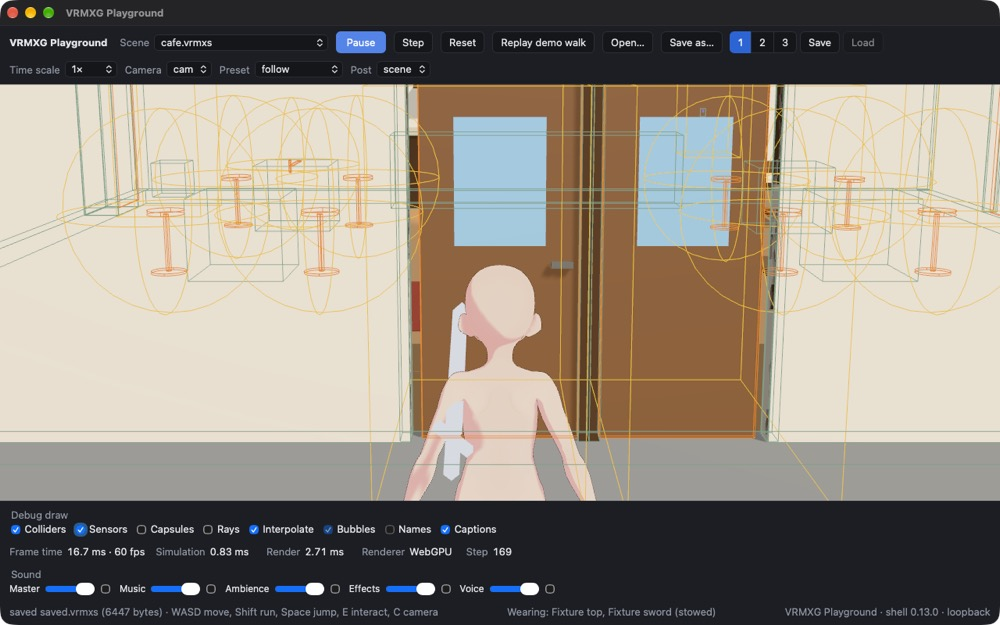
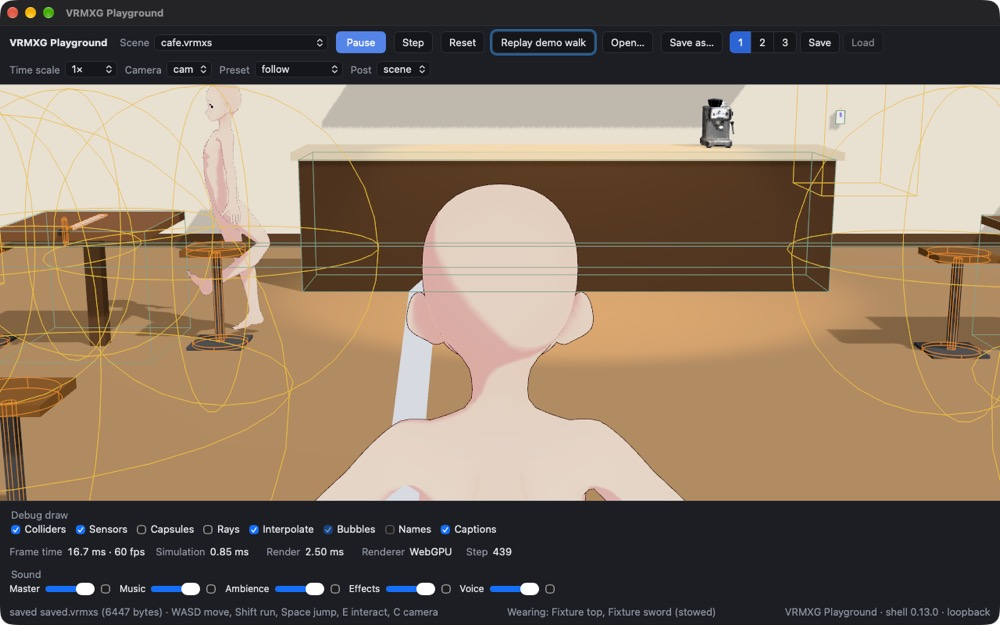

# Playground hand test (M0): AppProbe scenario: run of Nov 25, 2026 at 3:57 PM

- **App:** VRMXG Playground 0.1.0 (1), apps/playground-mac/build/VRMXGPlayground.app
- **Scenario:** `apps/playground-mac/docs/hand-test/HAND-TEST-M0.scenario.md`
- **Checklist:** `apps/playground-mac/docs/HAND-TEST-M0.md`
- **Result:** 7 rows: 5 passed, 0 failed, 2 need you; 0 checklist rows have no steps

## Needs you

### 6. Debug draw: ticking Colliders shows the wireframes (a person looks)

** (checklist line 10)

> Debug draw: ticking Colliders shows the wireframes (a person looks).

- 👀 shot 1: debug draw



<details><summary>Steps (1355 ms)</summary>

```
67: act id=play action=press → {"action":"press","delivery":"delivered","element":{"frame":{"h":28,"w":65,"x":3630,"y":380},"help":"","id":"play","name":"Play","ref":"W:VRMXG Playground/0/0/0 (10 ms)
68: act role=checkbox name=Colliders exact=true action=press → {"action":"press","delivery":"delivered","element":{"frame":{"h":13,"w":12,"x":3214,"y":1012},"help":"","name":"Colliders","ref":"W:VRMXG Playground/0/0/0/0/2/0 (11 ms)
69: act role=checkbox name=Sensors exact=true action=press → {"action":"press","delivery":"delivered","element":{"frame":{"h":13,"w":13,"x":3296,"y":1012},"help":"","name":"Sensors","ref":"W:VRMXG Playground/0/0/0/0/2/0/2 (22 ms)
71: shot "debug draw" (111 ms)
```
</details>

### 7. Replay demo walk: Mira walks in through the entrance door (a person looks)

** (checklist line 11)

> Replay demo walk: Mira walks in through the entrance door (a person looks).

- 👀 shot 1: demo walk



<details><summary>Steps (4405 ms)</summary>

```
77: act id=replay action=press → {"action":"press","delivery":"delivered","element":{"frame":{"h":28,"w":132,"x":3830,"y":380},"help":"","id":"replay","name":"Replay demo walk","ref":"W:VRMXG P (15 ms)
79: shot "demo walk" (115 ms)
```
</details>

## Passed

- **1. The cafe loads: Play is enabled, the camera list holds `cam`, no error shows** (checklist line 5): find("id=play").0.name == "Play"; find("role=popupbutton name=cam").count >= 1; find("role=statictext text=Error").count == 0 (2758 ms)
- **2. The shell answers the page: the status bar names the app, the shell version and the origin** (checklist line 6): find("id=shell-info").0.name matches "^Shell VRMXG Playground · shell [0-9.]+ · loopback$" (199 ms)
- **3. Open… and Save as… go through the shell: a scene opens from a file and saves back to one** (checklist line 7): find("id=notes").0.name matches "^open.vrmxs · [0-9]+ nodes$"; find("id=notes").0.name matches "^saved saved.vrmxs \\([0-9]+ bytes\\)$" (1425 ms)
- **4. Play runs the simulation: the button turns into Pause, the step count climbs and the fram…** (checklist line 8): find("id=play").0.name == "Pause"; find("id=frame-time").0.name matches "^Frame time [0-9.]+ ms · [0-9]+ fps$"; find("id=step-count").0.name != $before (1848 ms)
- **5. Pause stops it: the step count holds; Step advances it** (checklist line 9): find("id=play").0.name == "Play"; find("id=step-count").0.name == $held; find("id=step-count").0.name != $held (1642 ms)
## Results rows

In the checklist's format, to copy in (`fill=true` writes the failures in, and ticks the passes).

| # | Step | What happened | Undo name | Task filed |
|---|------|---------------|-----------|------------|
| 6 | Debug draw: ticking Colliders shows the wireframes (a person looks) | for you to judge: shot 1: debug draw | (none) | |
| 7 | Replay demo walk: Mira walks in through the entrance door (a person looks) | for you to judge: shot 1: demo walk | (none) | |
