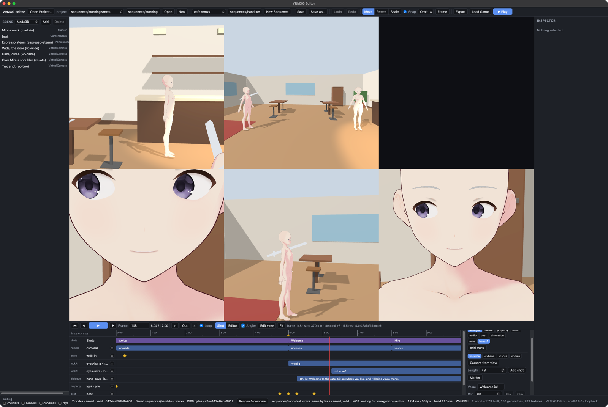

# Timeline hand test (M2 W5): AppProbe scenario: run of Nov 24, 2026 at 11:09 AM

- **App:** VRMXG Editor 0.1.0 (1), apps/editor-mac/build/VRMXGEditor.app
- **Scenario:** `apps/editor-mac/docs/hand-test/HAND-TEST-M2-TIMELINE.scenario.md`
- **Checklist:** `apps/editor-mac/docs/HAND-TEST-M2-TIMELINE.md`
- **Result:** 8 rows: 7 passed, 0 failed, 1 need you; 0 checklist rows have no steps

## Needs you

### 8. The preview plays in real time, through the shot camera, and the multi-angle view shows t…

** (checklist line 15)

> The preview plays in real time, through the shot camera, and the multi-angle view shows the shot and every virtual camera.

- 👀 shot 1: angles
- ✅ `find("id=tl-scrub").0.name matches "^Showing frame 100 "`
- ✅ `find("id=tl-frame").0.value >= 130`
- ✅ `find("name='Angles: shot, vc-wide, vc-hana, vc-ots, vc-two' exact=true").count >= 1`
- ✅ `find("id=holds").0.name matches "^Holds [12] worlds of [0-9]+ built"`



<details><summary>Steps (5240 ms)</summary>

```
127: act id=tl-frame action=set_value value=100 → {"action":"set_value","delivery":"delivered","element":{"frame":{"h":27,"w":83,"x":3131,"y":1436},"help":"","id":"tl-frame","name":"Frame","ref":"W:VRMXG Editor (438 ms)
128: until find("id=tl-scrub").0.name matches "^Showing frame 100 " → ok (29 ms)
129: act id=tl-play action=press → {"action":"press","delivery":"delivered","element":{"frame":{"h":27,"w":78,"x":2968,"y":1436},"help":"","id":"tl-play","name":"Play sequence","ref":"W:VRMXG Edi (46 ms)
131: act id=tl-play action=press → {"action":"press","delivery":"delivered","element":{"frame":{"h":27,"w":78,"x":2968,"y":1436},"help":"","id":"tl-play","name":"Pause sequence","ref":"W:VRMXG Ed (22 ms)
132: expect find("id=tl-frame").0.value >= 130 → ok (63 ms)
133: act id=tl-angles action=press → {"action":"press","delivery":"delivered","element":{"frame":{"h":13,"w":13,"x":3586,"y":1443},"help":"","id":"tl-angles","name":"Angles","ref":"W:VRMXG Editor/0 (31 ms)
134: until find("name='Angles: shot, vc-wide, vc-hana, vc-ots, vc-two' exact=true").count >= 1 → ok (1156 ms)
135: until find("id=holds").0.name matches "^Holds [12] worlds of [0-9]+ built" timeout=20000 → ok (535 ms)
136: shot "angles" (105 ms)
```
</details>

## Passed

- **1. A new sequence films the cafe: it opens with an empty timeline and a CameraBrain on the s…** (checklist line 8): find("id=doc-state").0.name matches "^Scene cafe"; find("id=project-name").0.name == "Project project"; find("id=doc-state").0.name matches "^Scene sequences/hand-test.vrmxs 1 nodes unsaved changes valid"; find("id=tl-head-shots").count == 1; find("id=tl-scrub").0.name == "No preview" (5143 ms)
- **2. Three shots are laid out from the timeline, each on a virtual camera, each one undo step …** (checklist line 9): find("id=undo").0.name == "Undo Add shot-cam from the view"; find("id=undo").0.name == "Undo Add shot-cam-2 from the view"; find("id=undo").0.name == "Undo Add shot Shot 1"; find("id=tl-scrub").0.name matches "^Showing frame 48 step 120 "; find("id=undo").0.name == "Undo Add shot Shot 2"; find("id=tl-scrub").0.name matches "^Showing frame 96 step 240 "; find("id=undo").0.name == "Undo Add shot Shot 3"; find("role=button name='Shot Shot 3 96 to 144' exact=true").count == 1; find("role=button name='Clip shot-cam 96 to 144' exact=true").count == 1 (6430 ms)
- **3. Animation, expression and dialogue tracks for Hana get a clip, a key and a line from the …** (checklist line 10): find("id=tl-head-hana-1-animation").count == 1; find("id=undo").0.name == "Undo Add clip to hana-1-animation @96"; find("id=tl-head-hana-1-expression").count == 1; find("id=undo").0.name == "Undo Key hana-1-expression.happy @96"; find("id=tl-head-hana-1-dialogue").count == 1; find("id=undo").0.name == "Undo Add clip to hana-1-dialogue @96"; find("role=button name='Clip Welcome in! 96 to 156' exact=true").count == 1 (10656 ms)
- **4. A selected key moves with the arrow keys, one undo step per press** (checklist line 11): find("id=undo").0.name == "Undo Move key hana-1-expression.happy to 97"; find("id=undo").0.name == "Undo Move key hana-1-expression.happy to 107"; find("role=button name='Key happy at 107' exact=true").count == 1 (2520 ms)
- **5. Undo walks the whole build back to the empty sequence, and redo returns it to the same do…** (checklist line 12): find("id=undo").0.enabled == false; find("id=doc-state").0.name matches "^Scene sequences/hand-test.vrmxs 1 nodes "; find("id=doc-state").0.name == $built; find("id=redo").0.enabled == false; find("id=holds").0.name matches "^Holds [12] worlds of [0-9]+ built" (28973 ms)
- **6. Save writes the sequence into the project; reopening it from disk gives the same bytes, a…** (checklist line 13): find("id=saved").0.name matches "^Saved sequences/hand-test.vrmxs · [0-9]+ bytes · [0-9a-f]{16}$"; find("id=verify-result").0.name == "Reopened sequences/hand-test.vrmxs: same bytes as saved, valid" (507 ms)
- **7. Scrubbing the morning sequence to frame 130 shows the world the runtimes agree on (accept…** (checklist line 14): find("id=doc-state").0.name matches "^Scene sequences/morning.vrmxs "; find("id=tl-scrub").0.name == "Showing frame 130 step 325 alpha 0 world 9a4aa4e6ff8e16d5"; find("id=tl-scrub").0.name == "Showing frame 40 step 100 alpha 0 world 32b88490608b5ce2"; find("id=tl-scrub").0.name == "Showing frame 200 step 500 alpha 0 world 3d22b0435f761522" (4626 ms)
## Results rows

In the checklist's format, to copy in (`fill=true` writes the failures in, and ticks the passes).

| # | Step | What happened | Undo name | Task filed |
|---|------|---------------|-----------|------------|
| 8 | The preview plays in real time, through the shot camera, and the multi-angle view shows t… | for you to judge: shot 1: angles; find("id=tl-scrub").0.name matches "^Showing frame 100 "; find("id=tl-frame").0.value >= 130; find("name='Angles: shot, vc-wide, vc-hana, vc-ots, vc-two' exact=true").count >= 1; find("id=holds").0.name matches "^Holds [12] worlds of [0-9]+ built" | (none) | |
