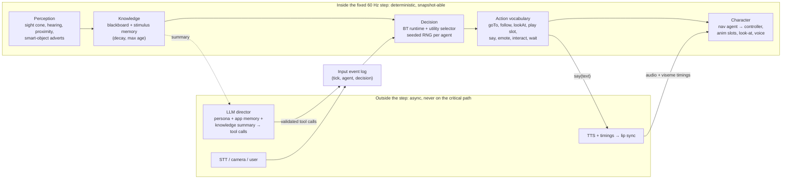

# NPC AI for VRMXG: research and recommendation

*Status: research pass, 2026-11-17. Input to PRD §5.7 (Navigation and NPC AI) and open question 6.
Nothing here is decided. Library facts were read from npm and GitHub on 2026-11-17.*

**Inputs:** `VRMXG-PRD.md` §3, §5.7, §5.21, §9; `vrmxa-game-engine-notes.md` ("NPC a.i."); VRMXA
`VRMXA-base-draft.md` §8 (animation slots), §10 (persona), §11 (memory); fleet receipts and package
docs found through the AgentBridge index (cited inline); `reference/Mage-master/src/entities/Entity.js`.

---

## 1. Recommendation

### 1.1 In one paragraph

Build a **layered NPC brain** in which everything that runs inside the fixed 60 Hz step is
deterministic, data-defined and agent-editable, and the LLM sits **outside** the step as a slow,
optional input source. **Perception** (sensors built on Rapier queries) writes a per-agent
**knowledge** store (blackboard plus stimulus memory). **Decision** is a behaviour tree runtime
with a **utility selector** node: utility scoring picks *which* behaviour to run, and behaviour
trees run *how* to do it. The optional **LLM director** reads a summary of the knowledge, the
persona and app memory, and answers with **tool calls** from a fixed action vocabulary (set a
goal, say a line, emote, look at, go to). Its replies enter the simulation as **recorded,
tick-stamped input events**, exactly like scripted input, so a shot replays without ever calling
the model again. **Action** is one vocabulary shared by the BT leaves, the LLM's tools, the shot
sequencer's cues and MCP's "drive" calls; it drives locomotion (nav agent → character
controller), VRMXA animation slots (`talk`, `listen`, `think`, `greet`, `emote.*`), look-at,
voice and lip sync.

### 1.2 The layers



| Layer | What it is | Data-defined | Deterministic | Where it runs |
|---|---|---|---|---|
| **Perception** | Sensors per agent: sight (range, FOV, LOS ray), hearing (stimulus events with loudness), proximity (Rapier sensors), smart-object adverts | Sensor config per role (ranges, angles, update rate) | Yes: Rapier queries are deterministic (spike), fixed staggered schedule | Step, time-sliced |
| **Knowledge** | Blackboard (typed variables) + stimulus memory records `{source, kind, lastPos, lastTick, strength}` that decay and expire | Blackboard plan (variable names, types, defaults) per tree, overridable per instance (LimboAI's "blackboard plans") | Yes; part of the world snapshot | Step |
| **Decision** | BT runtime: composites, decorators, conditions, actions, plus a **utility selector** composite whose children carry considerations (input → response curve → score) | Trees and considerations are JSON documents; role presets bundle them | Yes: tick-driven, no promises, no wall clock, seeded RNG stream per agent | Step (every tick or every N ticks per LOD) |
| **LLM director** (optional) | Picks goals, writes lines, answers the user; returns tool calls | Prompt template per role (app side), tool schemas generated from the action registry | **No**, so its outputs are recorded as inputs | Async, off the step, local MLX model |
| **Action** | One registry of character commands | Each action has a JSON Schema in the engine registry (§3.5 of the PRD's principles) | Yes | Step |
| **Character** | Nav agent, controller, anim-slot resolution (`vrmxa-core/anim`), look-at, lip sync | Animation sets come from the VRMXA | Yes, except audio | Step; audio is presentation |

### 1.3 Decisions in short

1. **Behaviour trees as the executor, utility AI as the chooser.** Not GOAP or HTN as the default.
   The standard roles are reactive and scripted-ish; BTs are the most legible format for agents
   and people to write as JSON, and utility scoring gives variety and persona flavour without
   planner cost or planner opacity. A top-level "mode" (guard: patrol / investigate / alert) is a
   utility selector or a guarded selector, not a separate FSM system. (§2)
2. **Write our own small BT runtime** (`vrmxg-ai`), with the node set and JSON shape modelled on
   **mistreevous** and the node-descriptor idea taken from **behavior3** (each node declares its
   args, blackboard inputs and outputs, and possible statuses, which is exactly what our registry
   needs to emit JSON Schema for the inspector and MCP). Reasons: node types must live in the
   engine registry (Principle 5); tree state must **serialize into world snapshots** for timeline
   scrubbing (§5.6), which no JS library offers; promises and `Date` must be impossible inside the
   step. Estimated at 800–1,500 lines. Use **mistreevous 4.3.1** in the M2 spike to validate the
   node set before writing ours; it is also the fallback. (§3)
3. **The LLM never steps the simulation.** It runs on its own clock and its decisions land at the
   next tick boundary as logged events. Replay and re-render read the log. Seeds are a convenience,
   not a replay mechanism (§4.3).
4. **The LLM speaks only the action vocabulary**, constrained twice: grammar-constrained decoding
   on the model side (the fleet's `mlx-constrained-decoding-swift`), and schema plus world
   validation on the engine side (target ids must be in the agent's perceived set, emotions must be
   in the persona's `allowed_expressions`, gestures must be slots the active animation set fills).
   An invalid reply falls back to the tree's default branch.
5. **The BT keeps the character alive while the LLM thinks**: `listen` while the user talks,
   `think` plus gaze aversion while the reply is generated, backchannel `nod`s. Latency is hidden by
   behaviour, not removed.
6. **Crowds and audiences never call the LLM.** Only "hero" characters do (conversation partner,
   companion, an optional shopkeeper or follower). One local model is shared through a priority
   queue.
7. **Persona maps to numbers once**: an app-side role profile (sociability, curiosity, boldness,
   energy, talkativeness, personal space) that weights utility considerations. Derived from the
   core persona at import (LLM-assisted, then editable), stored as app data, never in the bundle
   (VRMXA §10.2, §11).

---

## 2. Decision architectures compared

| Approach | How it decides | Strengths | Weaknesses | JSON / agent authoring | Determinism | Cost per agent | Best for |
|---|---|---|---|---|---|---|---|
| **FSM / HSM** (Mage's per-entity xstate machine; UE StateTree is a hybrid) | Explicit states and transitions | Simple, visual, cheap; great for turn-taking and animation-like modes | Transition explosion as behaviours grow; reuse is poor; HSM helps | Good: statecharts are JSON (xstate config) | Easy if the clock is the tick (xstate's `SimulatedClock`) | Very low | Conversation turn-taking, door/shop states, top-level modes |
| **Behaviour tree** (Halo 2 onward; LimboAI, Beehave, UE BT) | Tick the tree from the root; priority by child order; guards/decorators interrupt | Modular, reusable subtrees, legible, industry standard, strong tooling precedent | Priority is static; "why did it do that" needs a debugger; utility-like variety needs extra nodes | **Best**: a tree is a nested JSON object with typed nodes; easy for an LLM or MCP to write and diff | Easy: synchronous ticks, seeded RNG for random nodes | Low (only the running branch is re-evaluated) | All standard roles as the executor |
| **Utility AI** (Dave Mark's Infinite Axis Utility System; The Sims-style needs) | Score every option from considerations (input → response curve), pick best or weighted-random | Organic, emergent variety; personality is just weights; graceful with many options | Tuning curves is fiddly; scores are opaque without a debug view; poor at sequencing | Good: considerations are data (`{input, curve, weight}`) | Easy with fixed-order evaluation and seeded weighted choice | Low–medium (scores × options; can be throttled to a few Hz) | Choosing *what* to do: wanderer, companion home life, audience reactions, persona flavour |
| **GOAP** (F.E.A.R., Orkin 2006) | A* over actions with preconditions/effects to reach a goal world state | Novel action chains; designers add actions, not transitions | Planner cost; world-state modelling effort; plans can look odd; harder to art-direct | Medium: actions are data, but the world-state vocabulary must be designed | Deterministic if tie-breaking is ordered | Medium–high at replan | Combat or survival sims; not our standard roles |
| **HTN** (Humphreys, Game AI Pro; Fluid HTN; Horizon Zero Dawn, Transformers) | Decompose a high-level task through methods into primitive tasks | Designer-shaped plans (more directable than GOAP); reasons about effects; good for multi-step chores | More machinery than BTs; replanning rules; small JS ecosystem | Medium–good: methods are data | Deterministic | Medium | Multi-step jobs (shopkeeper restocking, a cook); possible later add-on |
| **Pure LLM agent** (Generative Agents; Project Sid's PIANO) | The model plans and picks every action | Open-ended, conversational, believable social behaviour | Latency (hundreds of ms to seconds), cost, non-determinism, hallucinated actions, say-do mismatch (PIANO notes it) | The "authoring" is prompts | **No** | Very high | Research sims; not a runtime executor |
| **LLM director + deterministic executor** (NVIDIA ACE CPCs, Convai Actions, Inworld Runtime graphs, LLM-reasoner + planner paper) | LLM chooses goals/lines; BT, planner or FSM executes | Open-ended intent with reliable, art-directed motion; executor hides latency | Two systems to keep coherent; needs a strict action schema and validation | Executor is data; LLM tool schemas generated from it | Yes, **if** LLM outputs are logged as inputs | LLM cost only for hero agents | Conversation partner, companion, commanded follower |

**Why BT + utility rather than one of them.** BTs are weak at "which of eight things should I do
now", and utility AI is weak at "do these five steps in order and handle failure". The common
production answer (and the one LimboAI and UE StateTree both lean toward, mixing selectors with
states) is to put a scoring selector at the top of trees whose branches are ordinary sequences.
Our `utility` composite is that node: each child is a subtree plus a list of considerations; the
composite re-scores at a set rate (for example 4 Hz) with hysteresis so the agent doesn't
dither.

**Smart objects.** Unreal's Smart Objects (and The Sims before them) put the knowledge of *how*
to use a thing on the thing: a bench advertises "sit" with slots and an animation; a shop counter
advertises "tend shop". This fits VRMXI items and set pieces well: a VRMXI item or scene node
declares its affordances (verb, slots, required tags, the animation slot to play), the utility
layer scores the advertisements a character perceives, and the BT runs a generic
"reach → claim → use → release" subtree. It keeps role trees small and lets level designers (and
agents) add behaviour by placing objects.

---

## 3. Libraries

### 3.1 JS/TS decision libraries (npm and GitHub, read 2026-11-17)

| Package | Version | Last release | Licence | Size (min / gzip) | Weekly downloads | Maintenance | JSON authoring | Determinism hooks | Verdict |
|---|---|---|---|---|---|---|---|---|---|
| **mistreevous** (nikkorn) | 4.3.1 | 2025-07-24 | MIT | 46.6 KB / 10.2 KB; 1 dep (`lotto-draw`) | ~2.9k | Single maintainer; dependency bumps through 2026-08 | **Yes**: JSON or MDSL; composites incl. `lotto` (weighted random), `race`, `all`; guards (`while`/`until`), callbacks | **`random` option** (seed every random choice) and **`getDeltaTime`** (no wall clock); `onNodeStateChange` for a debugger | Best off-the-shelf. Use for the spike and as the reference for our node set. Gaps: no state serialize/restore, async promise actions (must be banned), no utility node, its schema isn't our registry |
| **behavior3** (codetypess/behavior3-ts) | 3.0.0 | 2026-11-09 | MIT | 637 KB unpacked (bundle size not measured) | ~80 | Active (commits 2026-11-12) | Yes: JSON exported by the Behavior3 editor | Timers via `context.update(dt)` | Design reference: node **descriptors** (`args`, `input`, `output`, `status`, `children`, `group`) that an editor validates against; blackboard wiring through declared inputs/outputs. Docs mostly Chinese; small user base |
| **behaviortree** (Calamari/BehaviorTree.js) | 3.0.0-beta.1 tagged latest (beta.2 2026-03-09; last stable 2.1.0, 2021) | 2026-03 (beta) | MIT | 12.9 KB / 3.1 KB; depends on `core-js` | ~390 | Slow; perpetual beta | Partial (registry of named nodes) | Manual | Skip |
| **xstate** (Stately) | 5.33.4 | 2026-11-07 | MIT | 46.8 KB / 14.5 KB | ~8.6M | Very active | Machine config is JSON with named actions/guards | **`SimulatedClock`** exported, so delays can run on tick time | Not the NPC brain; good for app and UI flows and possibly the conversation turn-taking chart. Mage (reference repo) uses xstate 4's `createMachine`/`interpret` per entity |
| **yuka** (Mugen87) | 0.7.8 | 2022-09-17 | MIT | 120 KB / 31.4 KB | ~15.7k | **Unmaintained**: last commit 2023-01-16; repo not archived | No (code-defined) | No | Do not depend. Mine for design: goal-driven agents (think/goal arbitration with desirability, after Buckland), steering behaviours, `Vision` (FOV + range + obstacles), `MemorySystem` (memory span, last-sensed time), fuzzy logic, trigger regions |
| **blueshell** (6 River Systems) | 5.3.0 | 2025-06-06 | ISC | 541 KB unpacked | ~170 | Maintained, robotics-oriented | Code | — | Skip |
| **@putervision/behavior-mcp** | 0.4.1 | 2026-10-03 | MIT | 531 KB unpacked | small; 8 GitHub stars | New | Yes | Claims 60 Hz ticks, "deterministic action replay over MCP" | Watch only: the same idea as ours (BT + MCP + replay), too immature to adopt |
| **goap-solver** | 0.4.0 | 2025-12-29 | MIT | 9.8 KB unpacked | small | New | Actions as data | Pure functional | Reference if GOAP is ever wanted |
| **htn-ai** (GamePlanHTN, Fluid HTN port) | 1.2.1 | 2025-11-03 | MIT | 763 KB unpacked | ~8 | Small | Domain built in code | — | Reference if HTN is wanted for chores |
| **@pluto-engine/ai** | 1.2.0 | 2026-09 | not stated | 20 KB unpacked | small | New | — | — | Skip (no licence or repo listed) |

Nothing on npm is a maintained, deterministic, snapshot-able, schema-described BT + utility
runtime. That gap, plus Principle 5 (one registry feeds the inspector, the scene format and MCP),
is the case for our own runtime. The cost is small: the BT core is a few hundred lines, and the
value is in the node library (leaf actions bound to our characters), which we would write anyway.

### 3.2 Navigation libraries (for the neighbouring §5.7 rows)

| Package | Version | Released | Licence | Size | Notes |
|---|---|---|---|---|---|
| **@recast-navigation/core** (isaac-mason) | 0.44.0 | 2026-10-30 | MIT | 180 KB unpacked + WASM | Recast + Detour in WASM: bake, query, **DetourCrowd** (avoidance), tile cache obstacles, off-mesh connections. WASM float maths is deterministic across engines |
| **navcat** (isaac-mason) | 0.4.1 | 2026-05-06 | MIT | 141 KB / 45 KB gzip | Pure JS nav mesh build and query, ~10.5k weekly; no WASM. Check its use of `Math.*` transcendental functions before putting it inside the deterministic boundary (§6) |

The navigation choice still wants its own spike (PRD open question 5). Both share an author and
API ideas; recast-navigation-js has the crowd simulation today.

### 3.3 Godot addons as design references

| Addon | Version | Licence | What to take |
|---|---|---|---|
| **LimboAI** (C++ module/GDExtension, Godot 4.6+) | v1.8.1, 2026-08-20; ~3.1k stars | MIT | BTs **and** HSMs that nest in each other; **blackboard plans** (variables with types declared on the tree, overridden per instance); **blackboard scopes** (share a scope across a squad); **BB parameters** (a task argument is either a literal or bound to a blackboard variable, which is the binding UI our inspector needs); visual debugger showing the running branch; built-in task docs |
| **Beehave** (GDScript) | v2.9.3, 2026-08-18; ~3.3k stars | MIT | Trees as **nodes in the scene tree** (fits our node model and editor tree); runtime debug view; performance monitors per tree; every feature unit-tested |
| UE **StateTree** + **Smart Objects** | UE 5.x | proprietary (docs public) | StateTree: selectors from BTs combined with states and transitions; Smart Objects: affordances live on objects, found by tag and area. Both are the clearest statement of the hybrid we recommend |
| Unity **Behavior** package | 1.0.x | Unity licence | Its "generate a branch from text" feature was turned off in 1.0.10 (2025-05-21) with the Muse sunset. Lesson: LLM-authored trees are worthwhile only when the output is a reviewable data document in the normal editor, which is what our MCP edit path gives |

---

## 4. LLM-driven characters

### 4.1 What the field converged on (2024–2026)

- **Director over executor is the shipping pattern.** NVIDIA's ACE "autonomous game characters"
  (CES 2025: PUBG Ally on Mistral-NeMo-Minitron-8B, inZOI's Smart Zoi, NARAKA, MIR5) use small
  language models for perception-informed planning and conventional game code to act. Convai's
  Character Actions turn intent into a fixed action list (Move, PickUp, Drop, …) executed by the
  engine; its narrative design puts LLM conversation inside authored sections and triggers.
  Inworld moved from a hosted character engine to **Inworld Runtime** (Aug 2025), a C++ graph
  engine that wires LLM, STT, TTS, memory and tools as a pipeline. Ubisoft's NEO NPC (2024) and
  **Teammates** (Nov 2025) put voice-commanded squadmates over Snowdrop's existing AI.
- **Research agrees.** "LLM Reasoner and Automated Planner" (arXiv 2501.10106, 2025) pairs an LLM
  that picks goals with a classical planner that guarantees feasible plans. Generative Agents
  (Park et al. 2023) supplied the memory stream → reflection → plan loop most companion designs
  still borrow. Project Sid's PIANO (Altera, 2024) runs modules concurrently at different rates and
  documents the "says one thing, does another" failure that a single action vocabulary prevents.
- **Player response is mixed.** GDC 2026 had an NVIDIA-presented large-scale player study ("What
  good are AI NPCs?"), and Teammates drew developer backlash. The lesson for us: LLM characters
  are a feature for the companion and conversation roles, not a default for every NPC.

### 4.2 Where the LLM sits in VRMXG

| Use | Cadence | Output | Examples |
|---|---|---|---|
| **Conversation** | Per user turn | `say` (+ emotion, gesture) and optional `setGoal` | Companion, conversation partner, shopkeeper small talk |
| **Goal choice** | On salient events or every 10–60 s | `setGoal(goalId, params)` from the role's goal list | Companion decides to water plants; follower decides to scout |
| **Commands** | When the user speaks to a follower | Parsed into actions | "Wait by the door", "Follow me" |
| **Authoring (offline)** | In the editor or anime creator | Trees, cue lists, lines as data documents via MCP | An agent writes a guard tree; a director drafts a shot's blocking |

It does **not** pick per-tick motion, steer, path, aim or animate. Those stay in the executor.

### 4.3 Keeping the simulation deterministic

1. **LLM decisions are inputs.** Every reply becomes an event
   `{tick, agentId, kind: "decision", calls: [...], source: {model, promptHash}}` appended to the
   same input log as scripted and user input. It is applied at the first tick boundary after it
   arrives (live) or at its recorded tick (replay). Snapshots plus the input log reproduce the run.
2. **Anime creator: bake.** Running a shot "live" records the decision track into the shot as an
   editable track (lines, emotions, goals). Re-renders and scrubbing replay the track and never call
   the model. Regenerating a line is an explicit edit, like re-recording a take. Same for TTS:
   the audio and its viseme timings are baked into the shot.
3. **Don't use seeds as replay.** The fleet's `mlx-lfm-llm-swift` supports `parameters.seed`
   (same prompt + seed reproduces on the same build), which is useful for tests. But model,
   quantization, kernel or batching changes break bit-identity (Thinking Machines showed batch
   size alone makes most endpoints non-deterministic). The log, not the seed, is the record.
4. **Executor stays live while waiting.** A pending request is a blackboard flag; the tree plays
   `think`, holds gaze, keeps idling. A timeout (for example 4 s) falls back to an authored line or
   behaviour. In replay the "pending" span is reproduced from the log's request and reply ticks.
5. **Companion app:** non-determinism is acceptable live, but the log is still written (for
   debugging and "why did she say that"), held as app memory under VRMXA §11 privacy rules.

### 4.4 Latency budget (from fleet measurements)

Measured on the M5 Max (Mac17,14), Release builds:

| Stage | Measured | Source |
|---|---|---|
| STT (warm) | 60–110 ms | `mlxengine-solutions/voice-chat-kit/README.md` |
| LLM dispatch → first token | ~50 ms (prefill is not the bottleneck) | same |
| LLM "think" block (LFM2.5 always reasons) | 600–1,400 ms, **dominates** | same |
| TTS first chunk (Gepard, warm) | ~200 ms | same |
| Steady-state turn to first audio | **~1.2 s** (first turn after launch 1.75 s with warm-up; 5.7 s cold) | same |
| LFM2.5-8B-A1B int4 decode | ~270 tok/s; 4.89 GB resident + ~1.1–1.3 GB activation | `mlxengine-think/PROD/mlx-lfm-llm-swift/README.md` |
| Lip sync vs audio (TalkingHead core on three-vrm) | mouth within −10 ms (ZONOS3 LACI timings), +30 ms (Kokoro), streamed first-word delay ~150 ms | AB-R-0888 |

What that means for NPCs:

- **Conversation**: ~1.2 s to first audio is above the ~200 ms human turn gap, so the character
  must cover it: `listen` with nods while the user speaks, `think` plus gaze aversion on end of
  turn, a short filler line if over ~1.5 s. Reasoning length is the only big lever left.
- **Director calls** (goal choice, commands) should use the non-reasoning mode and short JSON
  replies (under ~60 tokens), which is roughly 50 ms + 0.25 s of decode on LFM2.5 int4: fine at
  event cadence, and never needed within a frame.
- **Many characters**: one resident model, a priority queue (the character the user is talking to
  first), at most one or two in-flight requests. Budget the LLM as a scarce shared resource.
- **Memory pressure**: LFM2.5 int4 + STT + TTS sat at ~9.85 GB together in voice-chat-kit. That is
  fine on the Studio and a concern on smaller Macs and iPhone; the companion app needs a
  smaller-model tier.

### 4.5 Getting from the web runtime to the model

The fleet's LLMs are Swift MLXEngine packages (`mlx-lfm-llm-swift`, `mlx-qwen-llm-swift`,
`mlx-gemma-llm-swift`), so the engine should talk to an **engine-owned `LanguageModel` adapter**
(Principle 6), with three backends:

1. **WKWebView shell**: a message-handler bridge (the avatar studio's `native.js` pattern) to an
   in-process `MLXServeEngine`. The main path for the companion and anime creator apps.
2. **Browser**: a loopback OpenAI-compatible endpoint, if one exists, or no director (trees only).
   The fleet has no general LLM HTTP server today that I found in the index; that is an open item.
3. **Replay**: reads the input log; no model at all.

### 4.6 Tool schema for character actions

Generated from the engine's action registry, filtered per character and per moment:

```json
{ "name": "say", "parameters": { "type": "object", "required": ["text"],
  "properties": {
    "text":    { "type": "string", "maxLength": 400 },
    "emotion": { "enum": ["happy", "relaxed"] },
    "gesture": { "enum": ["nod", "shrug", "point", "laugh"] },
    "to":      { "enum": ["user", "npc:7f3a"] } } } }
```

- `emotion` is filled from the persona's `allowed_expressions` (VRMXA §10.1), so a reply can only
  carry faces the character is allowed and every compliant app can show.
- `gesture` lists only the slots the **active animation set** fills (`vrmxa-core/anim`
  `resolveSlots`), so the model can't ask for a clip the character doesn't have.
- `to`, `lookAt`, `goTo` and `interact` targets are enums of ids **from the agent's perceived
  set**, which stops omniscience and hallucinated ids.
- Starting vocabulary: `say`, `emote(slot)`, `gesture(slot)`, `lookAt(target)`,
  `goTo(target | mark, pace)`, `follow(target, distance)`, `interact(item, verb)`,
  `setGoal(goal, params)`, `wait(seconds)`, `endConversation()`.
- The fleet's `mlx-constrained-decoding-swift` guarantees syntactically valid JSON today (container
  hint only; full schema enforcement is "a later, additive upgrade"), so the engine still validates
  against the schema and the world. LFM2.5 also has native tool calling (`<|tool_call_start|>`).

---

## 5. Perception

### 5.1 Standard design

| Sense | Test | Typical parameters | Cost control |
|---|---|---|---|
| **Sight** | Broadphase candidates in range → dot-product cone test → line-of-sight ray (Rapier `castRay` with a vision collision group) to one or more points (head, chest) | Range, FOV (e.g. 110°), peripheral cone with lower gain, eye bone as origin (VRM `lookAt` head) | Rays only for candidates inside the cone; staggered updates at 5–10 Hz; ray budget per tick |
| **Hearing** | Stimulus events (`footstep`, `speech`, `crash`) with loudness radius; listener inside radius hears it, optionally attenuated by occlusion or nav distance | Loudness per event type, listener sensitivity | Event-driven: no polling |
| **Proximity / touch** | Rapier sensor colliders (`Area` equivalents) | Personal-space radius from the role profile | Free from the physics step |
| **Interest points / smart objects** | Objects advertise affordances within a radius; perceived like sight | Advert radius, required tags | Spatial hash; evaluated by the utility layer at its own rate |
| **The user** (companion) | Camera presence, face direction, voice activity → stimulus events from outside the step, logged as inputs | — | Native side |

### 5.2 Stimulus memory

Each agent keeps records `{sourceId, kind, lastKnownPos, lastSensedTick, firstSensedTick,
strength, visibleNow}`. Strength accumulates while sensed (a guard's suspicion meter) and decays
when not; a record expires after `maxAge` (Unreal's AI Perception has exactly this per sense,
where 0 means never forget; Yuka's `MemorySystem` uses a memory span). Trees query memory, not
raw sensors ("last known position of the player"), which gives believable search behaviour and
keeps BT conditions cheap.

### 5.3 Cost

Order of magnitude for planning (not measured here): with candidates culled by range and cone
first, a sight update is a handful of ray casts per agent. At 30 agents updating sight at 10 Hz
with 2 rays each, that is ~10 rays per 60 Hz tick, small next to the physics step. Audiences and
far crowds skip sight entirely (event-driven reactions only). This should be measured in the M2
navigation and AI spike, with the same rigour as the physics spike.

---

## 6. How it ties to VRMXA

| VRMXA | Becomes in the NPC system |
|---|---|
| Core persona `personality`, `traits` (§10.1) | A **role profile** of numbers (sociability, curiosity, boldness, energy, talkativeness, personal space, patience) weighting utility considerations. Derived once by the LLM from persona text, editable, stored as app persona (§10.2), never in the bundle |
| `speech_style`, `languages`, `persona_example` | The LLM prompt for `say` (app framing laid over core persona, then app memory, then the conversation, in §11's order) |
| `rest_expression` | The face the executor returns to between beats |
| `allowed_expressions` | The `emotion` enum in tool schemas; the `emote.*` slots the tree may play |
| `voice_id` (§9) | TTS voice for `say`; licence and consent fields respected before cloning |
| Animation slots (§8.2) | **Action outputs**: `idle`/`walk`/`run` from locomotion; `talk`, `listen`, `think` from the conversation tree; `greet`, `nod`, `shake`, `shrug`, `point`, `laugh`, `bow`, `clap` as gestures; `emote.*` for emotions; `sit`/`sitIdle`/`stand` and `use` from smart objects; `x-<vendor>.*` for game-specific moves. Set selection by equipped tags (§8.3) stays in `vrmxa-core/anim`, so a guard holding a sword walks with the sword set without the tree knowing |
| Memory (§11) | Lives in each app, keyed by character UUID (and user). The engine exposes a memory-provider hook for the director; the engine itself stores none |
| Voice + lip sync | `say` → TTS with word timings → TalkingHead-derived viseme envelope on VRM `aa ih ou ee oh` (AB-R-0888: ZONOS3 LACI timings within 10 ms of the audio, no aligner pass). The `talk` slot plays body motion while the mouth comes from visemes |

**Determinism boundary for this system.** Inside: perception queries, knowledge, BT ticks,
utility scores, seeded RNG (one stream per agent, seeded from scene seed + agent id), nav and
crowd steps, animation-slot choice. Outside, entering as logged inputs: LLM replies, STT, camera
input, TTS audio and timings. One JS-specific trap: `+ − × ÷` and `Math.sqrt` are exact IEEE-754
everywhere, but `Math.sin/cos/atan2/exp/pow` are implementation-defined and may differ between
V8 and JavaScriptCore. Response curves should use our own polynomial or table forms, and AI code
inside the boundary should use the engine's deterministic maths helpers. Rapier's
deterministic build already avoids this (the spike's V8/JSC bit-identity).

---

## 7. Role catalogue mapped to the architecture

| Role | Perception | Decision (utility picks → BT runs) | LLM | Main animation slots | Notes |
|---|---|---|---|---|---|
| **Wanderer** | Sight (low rate), smart-object adverts | Utility: wander / idle / inspect point of interest / sit on bench; BT: pick seeded reachable point → `goTo` → idle stop | No | `idle`, `walk`, `sit`, `sitIdle`, `point` | Seeded RNG keeps shots repeatable |
| **Audience / crowd** | None per agent; listens to **stage events** | Shared "crowd brain" maps events to reactions with seeded per-agent delay and choice; LOD: far agents animation only | No | `clap`, `laugh`, `emote.*`, `idle` variants | Clone cost is the limit (VRMs re-parsed per copy, §5.5); one evaluator for many agents |
| **Guard** | Sight cone, hearing, memory with suspicion meter | Utility/guarded selector over modes: patrol → suspicious (look) → investigate last known position → alert/chase → search → return | Optional: barks and dialogue only | `walk`, `run`, `point`, `shake`, `emote.angry` | Classic stimulus-memory showcase |
| **Shopkeeper** | Proximity (customer zone), sight | Anchored to a counter smart object; greet on arrival, serve (VRMXI interaction), chores when idle (an HTN-style chore list is a later option) | Optional: small talk with persona; **game rules stay authoritative** (the LLM proposes, the shop system decides prices and stock) | `greet`, `talk`, `listen`, `bow`, `use` | |
| **Follower** | Sight of leader, nav distance | Follow at distance (nav agent), catch up / teleport rule, wait at points, react to threats; commands from the director | Optional: voice commands → `follow`/`wait`/`goTo`; comments on the world | `walk`, `run`, `idle`, `nod` | Ubisoft Teammates / PUBG Ally pattern |
| **Conversation partner** | User or NPC speaker, gaze, voice activity | Turn-taking chart: attend → listen → think → talk → idle, with interrupts (user barge-in) | **Yes** | `listen`, `think`, `talk`, `nod`, `greet`, `emote.*` + visemes | Latency covered by `think` and gaze (§4.4) |
| **Companion** (app) | User presence via camera, voice, time of day | Conversation partner + home-life utility (needs: energy, boredom, social; schedule); lower tick rate when the user is away (low power) | **Yes** (conversation and goal choice) | All of the above + `sit`, `x-` home activities | Memory in the app (§11) |
| **Performer / actor** (anime creator, spokesmodel) | Marks and cues | Cue-driven tree: run the shot's cue (`goTo mark`, `say line`, `gesture`) then hold idle; cues are the same action vocabulary | Offline only: drafts cue lists and lines, baked into the shot | Any | Fully deterministic at render time |

Each role ships as a **role preset**: a data document bundling a tree, its utility
considerations, a blackboard plan, a perception config and default role-profile weights. A scene
attaches a preset to a character node and overrides variables per instance.

---

## 8. What is data, what is code, what MCP sees

| Data (JSON documents, editor- and MCP-editable) | Code (registered in the engine) |
|---|---|
| Behaviour trees, utility considerations and curves, blackboard plans, role presets, perception configs, smart-object affordances on items and set pieces, director prompt templates (app side), shot decision tracks | Node types (composites, decorators, conditions, leaf actions), sensors, curve functions, the action registry, the LLM adapter |

MCP (PRD §5.21): **Describe** lists node types and actions with JSON Schemas from the registry;
**Inspect** reads a live agent's running branch, blackboard, memory and last utility scores (the
debugger view LimboAI and Beehave both show); **Edit** writes trees and presets as data, undoable;
**Drive** sends actions to a character (already P0 "cue a character"). An agent can therefore both
author an NPC and act as its director.

---

## 9. Risks

| Risk | Mitigation |
|---|---|
| Our own runtime takes longer than planned or grows into a framework | Keep the core to BT + utility + blackboard; spike with mistreevous first to fix the node set; no editor until the data format settles |
| LLM say-do mismatch (says "I'll get it" and doesn't) | One action vocabulary; `say` and actions arrive in the same validated reply; the executor reports failures back to the director |
| Hallucinated targets, emotions or gestures | Enums built from perception, persona and the active animation set; schema + world validation; fallback branch |
| Latency breaks the illusion | Behaviour covers it (`listen`/`think`/gaze/fillers); non-reasoning mode for director calls; priority queue |
| Non-determinism leaks into shots | LLM, STT, TTS and camera only enter through the input log; anime creator bakes tracks; CI replays a recorded shot and compares snapshots |
| Cross-engine float differences in AI maths | Deterministic maths helpers; ban `Math.random` and transcendental `Math.*` in step code (lint rule); test V8 vs JSC like the physics spike |
| Utility dithering and opaque scores | Hysteresis and commitment time; score debugger in the inspector |
| Memory and power on smaller devices (companion, iPhone) | Small-model tier; director cadence throttled; AI LOD and lower tick rates when idle |
| Privacy of conversation logs | Logs are app memory (VRMXA §11): kept in the app, keyed by character and user, never in bundles or shared scenes |
| Player and developer reception of "AI NPCs" | LLM only where it is the feature (companion, conversation); everything else is authored behaviour |
| Browser builds have no local LLM path | Trees-only fallback; loopback endpoint as an open item |

---

## 10. Suggested PRD §5.7 rows

| Feature | Godot | VRMXG | Pri |
|---|---|---|---|
| Behaviour | nothing built in (addons: LimboAI, Beehave) | Engine-owned BT runtime with a **utility selector** node, JSON trees and role presets, node types in the registry (MCP-describable), tree state in world snapshots; seeded RNG per agent; mistreevous as spike and reference | P1 |
| Standard roles | none | Role presets: wanderer, audience/crowd, guard, shopkeeper, follower, conversation partner, performer (cue-driven) | P1 |
| Smart objects | none | Items and set pieces advertise affordances (verb, slots, tags, anim slot); utility scores them, a generic BT uses them | P1 |
| Perception | none | Sight cone + LOS rays, hearing events, proximity sensors, stimulus memory with decay and max age; staggered, budgeted | P1 |
| Persona-driven characters | none | Optional LLM director off the fixed step, via an engine `LanguageModel` adapter (MLX through the WKWebView bridge); replies are **tool calls** from the action vocabulary, validated, and **logged as input events** for replay; anime creator bakes them into the shot; memory stays in the app (VRMXA §11) | P1 (conversation), P2 (goal choice) |
| Action vocabulary | none | One registry of character actions (`goTo`, `follow`, `lookAt`, `say`, `emote`, `gesture`, `interact`, `setGoal`, `wait`) shared by BT leaves, LLM tools, shot cues and MCP drive | P0 (it is MCP "cue a character") |
| AI debugger | (addons) | Running branch, blackboard, memory and utility scores in the inspector and over MCP inspect | P1 |

And open question 6 could read: *"Behaviour trees as the executor with utility selection inside
them; an optional LLM director above, outside the deterministic step, whose decisions are recorded
as inputs. Proposed in `research/npc-ai.md`."*

---

## 11. Sources

**Fleet (AgentBridge index)**
- AB-R-0888, VRM lip-sync spike: `AgentBridge-Store/records/receipt/AB-R-0888.md`
- LFM2.5-8B-A1B package (tool calling, seed, throughput, footprint): `mlxengine-think/PROD/mlx-lfm-llm-swift/README.md`
- Voice-chat turn latency (STT, first token, think, TTS): `mlxengine-solutions/voice-chat-kit/README.md` ("Measured (M5 Max, Release)")
- LLM package inventory and tool-call planes: `mlxengine-think/Docs/think-package-notes.md`
- Constrained decoding: `mlxengine-think/PROD/mlx-constrained-decoding-swift/README.md`
- Mage per-entity xstate machine: `vrmxa-game-engine/reference/Mage-master/src/entities/Entity.js:1, 440`

**Libraries**
- mistreevous: https://github.com/nikkorn/mistreevous · https://www.npmjs.com/package/mistreevous
- behavior3-ts: https://github.com/codetypess/behavior3-ts · https://www.npmjs.com/package/behavior3
- BehaviorTree.js: https://github.com/Calamari/BehaviorTree.js
- XState (incl. `SimulatedClock`): https://github.com/statelyai/xstate · https://stately.ai/docs
- Yuka: https://github.com/Mugen87/yuka · https://mugen87.github.io/yuka/
- blueshell: https://github.com/6RiverSystems/blueshell
- behavior-mcp: https://github.com/putervision/behavior-mcp
- goap-solver: https://github.com/13luck/goap-solver · htn-ai: https://github.com/TotallyGatsby/GamePlanHTN
- recast-navigation-js: https://github.com/isaac-mason/recast-navigation-js · navcat: https://github.com/isaac-mason/navcat
- Bundle sizes: https://bundlephobia.com (queried 2026-11-17); downloads: https://api.npmjs.org/downloads/point/last-week/
- LimboAI: https://github.com/limbonaut/limboai · https://limboai.readthedocs.io
- Beehave: https://github.com/bitbrain/beehave

**Architectures**
- Orkin, "Three States and a Plan: The A.I. of F.E.A.R." (GDC 2006): https://www.gamedevs.org/uploads/three-states-plan-ai-of-fear.pdf
- Humphreys, "Exploring HTN Planners through Example" (Game AI Pro, ch. 12): http://www.gameaipro.com/GameAIPro/GameAIPro_Chapter12_Exploring_HTN_Planners_through_Example.pdf
- Graham, "An Introduction to Utility Theory" (Game AI Pro, ch. 9): http://www.gameaipro.com/GameAIPro/GameAIPro_Chapter09_An_Introduction_to_Utility_Theory.pdf
- Dave Mark, Infinite Axis Utility System talks (list): https://intrinsicalgorithm.com/works.php
- Unreal StateTree: https://dev.epicgames.com/documentation/en-us/unreal-engine/overview-of-state-tree-in-unreal-engine
- Unreal Smart Objects: https://dev.epicgames.com/documentation/unreal-engine/smart-objects-in-unreal-engine---overview
- Unreal AI Perception (sight radius, hearing range, max age): https://dev.epicgames.com/documentation/en-us/unreal-engine/ai-perception-in-unreal-engine
- Unity Behavior generative AI (disabled in 1.0.10): https://docs.unity3d.com/Packages/com.unity.behavior@1.0/manual/about-genai.html · https://discussions.unity.com/t/behavior-package-1-0-10-released-changelog-inside/1648231

**LLM characters**
- NVIDIA ACE autonomous game characters (CES 2025): https://www.nvidia.com/en-eu/geforce/news/nvidia-ace-autonomous-ai-companions-pubg-naraka-bladepoint/
- PUBG Ally / inZOI coverage: https://www.digitaltrends.com/gaming/inzoi-pubg-ai-cpc-characters-ces-2025/
- Inworld Runtime (Aug 2025): https://www.ciodive.com/press-release/20250812-inworld-runtime-the-first-ai-runtime-for-consumer-applications/ · Character Studio deprecation: https://docs.inworld.ai/character-studio-deprecation
- Convai character actions: https://convai.com/blog/integrating-dynamic-npc-actions-for-game-development-with-convai · narrative design: https://docs.convai.com/api-docs/plugins-and-integrations/convai-unreal-engine-plugin/features/narrative-design
- Ubisoft Teammates (Nov 2025): https://news.ubisoft.com/en-us/article/3mWlITIuWuu0MoVuR6o8ps/ubisoft-reveals-teammates-an-ai-experiment-to-change-the-game
- Puerta-Merino & Sabater-Mir, "LLM Reasoner and Automated Planner: A new NPC approach" (2025): https://arxiv.org/abs/2501.10106
- Park et al., "Generative Agents" (2023): https://arxiv.org/abs/2304.03442
- Altera, "Project Sid: Many-agent simulations toward AI civilization" (PIANO): https://arxiv.org/abs/2411.00114
- PORTAL, "Agents Play Thousands of 3D Video Games" (2025): https://arxiv.org/abs/2503.13356
- Thinking Machines, "Defeating Nondeterminism in LLM Inference" (Sep 2025): https://thinkingmachines.ai/blog/defeating-nondeterminism-in-llm-inference/
- GDC 2026, "What good are AI NPCs? Lessons from a large-scale player study": https://schedule.gdconf.com/session/what-good-are-ai-npcs-lessons-from-a-large-scale-player-study-presented-by-nvidia/917528

*Not verified here: the F.E.A.R. PDF mirror URL (the paper is widely mirrored; the original was on
Orkin's MIT page); the PUBG Ally model name comes from launch coverage, not a current Krafton page;
the perception cost in §5.3 is an estimate to be measured.*
